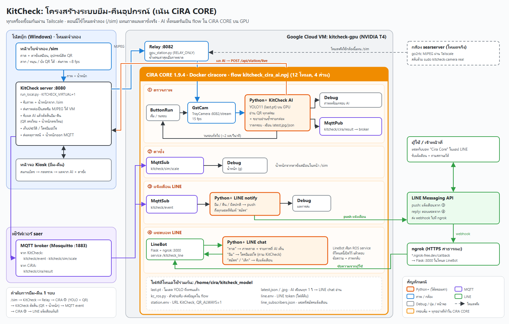

# KitCheck: ตู้ยืม–คืนเครื่องมืออัตโนมัติด้วย AI + CiRA CORE

ระบบยืม–คืนเครื่องมือช่างแบบบริการตัวเอง ผู้ใช้วางเครื่องมือบนถาด กล้องกับ AI (YOLO11) บอกว่าเป็นเครื่องมืออะไร
อ่านป้าย QR ที่ติดแต่ละชิ้นว่าเป็นชิ้นไหน และใช้ตาชั่งยืนยันน้ำหนักอีกชั้น ถ้าไม่ตรงจะส่งให้เจ้าหน้าที่ตรวจ
งานฝั่ง AI ทั้งหมดรันเป็น flow ใน **CiRA CORE**



## โครงสร้างโฟลเดอร์

| โฟลเดอร์ | คืออะไร |
|---|---|
| `server/` | เซิร์ฟเวอร์ KitCheck (Python, FastAPI): หน้าเจ้าหน้าที่ `/`, หน้าตู้ `/kiosk`, ถาดจำลอง `/sim`, ฐานข้อมูลยืม–คืน, MQTT |
| `server/deploy-linux/` | สคริปต์ติดตั้งเซิร์ฟเวอร์จริงบน Linux (nginx, MQTT, กล้อง, CiRA ใน Docker) ไม่จำเป็นสำหรับเดโม |
| `cira/` | โค้ดในโหนด Python+ ของ CiRA CORE และตัวสร้างไฟล์ flow (`.npj`) |
| `kiosk-esp32/` | เฟิร์มแวร์จอตู้ Waveshare ESP32-S3-Touch-LCD-5B (PlatformIO, LVGL 9) |
| `docs/` | แผนภาพโครงสร้างระบบ |

## ภาพรวมการทำงาน

1. **ถาด + ตาชั่ง**: ของจริง หรือหน้า `/sim` (ถาดจำลองให้ลากเครื่องมือที่ติด QR ใส่ได้ พร้อมตาชั่งเสมือน)
2. **KitCheck** ส่งภาพเป็นสตรีม MJPEG ไปที่เครื่อง GPU
3. **CiRA CORE** (flow `cira/kitcheck_cira_ai.npj`, 12 โหนด)
   - ① ตรวจภาพ: `GstCam` → `Python+ KitCheck AI` (YOLO11 บน GPU + อ่าน QR ทุกเฟรม) → ส่งผลกลับ KitCheck และ `MqttPub`
   - ② ตาชั่ง: `MqttSub kitcheck/sim/scale` → `Debug`
   - ③ แจ้งเตือน LINE: `MqttSub kitcheck/event` → `Python+ LINE notify`
   - ④ แชตบอท LINE: `LineBot` ⇄ `Python+ LINE chat` (พิมพ์ ถาด / ยืม / สมัคร / เลิก)
4. **KitCheck** ตัดสินยืม–คืนจาก QR + น้ำหนัก แล้วบันทึกประวัติพร้อมภาพหลักฐาน
5. **จอตู้ ESP32** แสดงขั้นตอนยืม–คืน ภาพถาดพร้อมกรอบ AI และตั้งค่า WiFi / เซิร์ฟเวอร์ได้จากจอ

## เริ่มใช้งาน (เซิร์ฟเวอร์ บนเครื่องตัวเอง)

```bash
cd server
python -m venv .venv
.venv\Scripts\activate          # Windows  (Linux/macOS: source .venv/bin/activate)
pip install -r requirements.txt
copy local.env.example local.env   # แล้วกรอกค่าใน local.env
python run_local.py
```

จากนั้นเปิด `http://localhost:8080/` (หน้าเจ้าหน้าที่), `/kiosk` (หน้าตู้) และ `/sim` (ถาดจำลอง)
ใช้ `python run_dev.py` ถ้าอยากได้ข้อมูลตัวอย่างไว้ลองเล่น

## CiRA CORE

- เปิด `cira/kitcheck_cira_ai.npj` ใน CiRA CORE (ทดสอบกับ 1.9.4) แล้วกรอกในหน้าตั้งค่าโหนด: MQTT user/password, LINE channel token/secret และ ngrok token
- โหนด Python+ อ่านไฟล์จาก `~/kitcheck_model/` บนเครื่อง CiRA: `last.pt` (โมเดล), `kc_ros.py`, `station.env`, `line.env`
- ไฟล์โมเดล `last.pt` ไม่ได้อยู่ใน repo เพราะไฟล์ใหญ่ ขอได้จากผู้จัดทำ
- `make_npj_cira_ai.py` สร้างไฟล์ flow ใหม่จากโค้ดใน `cira/`

## จอตู้ ESP32-S3

```bash
cd kiosk-esp32
copy include\secrets.example.h include\secrets.h   # แล้วกรอกค่า
pio run -t upload
```

- ตั้ง WiFi ได้จากจอ: แตะชิป WiFi มุมขวาบน แล้วใส่รหัสเจ้าหน้าที่ (`KIOSK_PIN`)
- ต่อ hotspot ของโน้ตบุ๊ก Windows แล้วจอจะใช้ KitCheck บนโน้ตบุ๊กเอง (`192.168.137.1:8080`)

## เครดิต

ภาพเครื่องมือในถาดจำลองมาจาก Roboflow Universe (CC BY 4.0) ดู `server/kitcheck/static/sim/CREDITS.txt`
